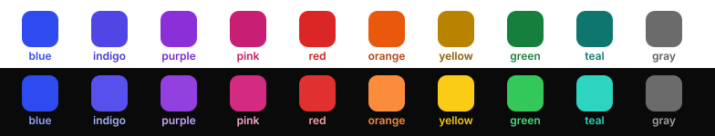

# Quickstart

> A Clegra app is an app that Clegra draws natively and that is also a plain MCP server for ChatGPT, Claude and any
> MCP client. One package, `@clegra/sdk` (ESM JavaScript with its
> types, Node 20+; `npm i @clegra/sdk@next zod`). Its design library is the separate package `@clegra/ui` (optional). For a Next.js app that already has data and a sign-in: **five
> minutes to see it, a day to ship it.**

## Next.js in 5 minutes

In an existing Next.js App Router app (`app/` or `src/app/`):

```sh
npm i @clegra/sdk zod         # before the first release: npm i ./clegra-0.1.0.tgz zod (the tarball of `npm pack`)
npx @clegra/sdk init          # --dry-run prints what it would do; --ui adds @clegra/ui, Clegra's design system
```

```text
clegra init: Next.js 16.4.6, App Router in app/, TypeScript, alias @/*, next.config.ts

  create  clegra.ts  (app "acme-tasks": sample tasks, one action, one page; TODOs for your data and sign-in)
  create  app/api/clegra/[...path]/route.ts  (imports { app } from "@/clegra")
  edit    next.config.ts  (wrapped the exported config with withClegra)
  create  .env.local  (CLEGRA_LOCAL_TOKEN: a random local bearer, refused in production)

Next:
  1. npm run dev   (then http://localhost:3000/.well-known/clegra.json is the manifest, http://localhost:3000/mcp the MCP server)
  2. npx @clegra/sdk check http://localhost:3000 --token <the token>
  3. MCP Inspector: npx @modelcontextprotocol/inspector, Streamable HTTP, http://localhost:3000/mcp, header Authorization: Bearer <the token>
  4. A day to ship: …
```

What it writes:

- **`clegra.ts`**: a working `defineApp` with one entity (`task`) on sample data kept in the file, scoped by
  `ctx.installation`, one confirmed action (`complete`) and one list page. Two `TODO`s mark where your database and
  your sign-in go.
- **`app/api/clegra/[...path]/route.ts`**: `export const { GET, POST, DELETE, OPTIONS } = toNextHandlers(app)`.
- **`next.config`** wrapped in `withClegra(…)`. It adds rewrites for `/mcp`, `/.well-known/clegra.json` and the
  OAuth metadata paths. init edits the file only when the edit is certain (one
  `export default <expression>` line). Otherwise it prints the edit for you to make.
- **`.env.local`**: `CLEGRA_LOCAL_TOKEN`, a random bearer.

init never overwrites a file. Running it twice only prints `skip`s. It warns about what would get in the way: a
`proxy.ts` (or `middleware.ts`) that would block `/mcp`, `basePath` or `trailingSlash: true` (which `withClegra`
refuses), a `.gitignore` that doesn't cover `.env.local`, and missing `@clegra/sdk`/`zod`.

Then:

```sh
npm run dev
npx @clegra/sdk check http://localhost:3000 --token <CLEGRA_LOCAL_TOKEN>
```

- **The MCP Inspector**: `npx @modelcontextprotocol/inspector`, transport Streamable HTTP, URL
  `http://localhost:3000/mcp`, header `Authorization: Bearer <CLEGRA_LOCAL_TOKEN>`. You see `task_list`,
  `task_get`, `task_complete`, `search`, `fetch`, `open_tasks` and `clegra_resolve`.
- **`clegra check`** runs every check. All of them pass but one: `auth.mcp — protected-resource metadata names no
  authorization server`. That is the honest state of a fresh app. MCP clients can't sign anyone in until
  `authorizationServers` names your sign-in, which is the first job of day one.

**The local bearer, and why it is safe.** The generated `resolve` accepts `CLEGRA_LOCAL_TOKEN` only when
`NODE_ENV` is not `production`. `next build`, `next start` and every deployment (Vercel previews included) set
`production`, and then the bearer is refused whatever the environment holds. In production without
`CLEGRA_PUBLIC_URL`, every request but the manifest gets a `500 misconfigured` that names the missing setting. The token is random
per project and lives in `.env.local`, which Next's `.gitignore` keeps out of git. The SDK's own dev sign-in
(`auth.dev`, a sign-in page for test people) does **not** exist under Next: it trusts only loopback callers, and a
route handler can't know the caller's address, so `toNextHandlers` refuses it. `auth.anonymous` (no token at all) is
not used either: it is a local demo's, refused in production. Operations anyone may call without signing in are
declared `public: true` with `auth.public` (spec §7, «Public operations»).

## Your app's colour

Each app has its own tint colour, like Apple's apps: Clegra draws the app's primary buttons, selected rows and
filters, links, switches and focus ring in it, and keeps its own chrome blue. Pick one name of the palette (never a
hex: the palette is tuned for light and dark and for contrast):

```ts
export const app = defineApp({ name: "acme-tasks", title: "Tasks", version: "1.0.0", accent: "teal", … })
```



| `accent` | Light | Dark |
| --- | --- | --- |
| `blue` (the default) | `#2D4BEE` | `#2D4BEE`, text `#8FA2FF` |
| `indigo` | `#4F46E5` | `#5850EC` |
| `purple` | `#8B2FD9` | `#9340E0` |
| `pink` | `#C81E73` | `#D42A82` |
| `red` | `#D02424` | `#E0302F` |
| `orange` | `#EA580C` | `#FB8C3C` |
| `yellow` | `#B88300` | `#FACC15` |
| `green` | `#127535` | `#34C759` |
| `teal` | `#0F716A` | `#2DD4BF` |
| `gray` | `#636363` | `#6B6B6B` |

Choose the one closest to your icon. Anything else fails when the app starts (`accent: "#00AA88" is not one of …`)
and in `clegra check` (`manifest.schema`). Without `accent` the manifest has none and hosts use `blue`.

## A day to ship

Work through the TODOs in `clegra.ts`:

1. **Your data in `get`, `list` and `run`.** Call the functions your pages already use, with `ctx.installation` as
   the tenant. [Your data layer](#your-data-layer) below shows a `list` over SQL.
2. **Your sign-in in `auth.resolve` and `auth.authorizationServers`.** Your auth library is the OAuth authorization
   server. `resolve` verifies its access tokens and names the caller. Recipes for better-auth, Clerk, Auth0 and
   WorkOS are in [auth.md](auth.md). Keep the `localCaller` line if you like; it never answers in production.
3. **The public address.** Set `CLEGRA_PUBLIC_URL=https://app.example.com` (an origin only) in each environment.
   `auth.resource` is then `https://app.example.com/mcp`, the only audience tokens are accepted for. Without it,
   production answers `500 misconfigured` (the manifest excepted). A client can send `x-forwarded-host`, so never rely on it. On Vercel,
   previews have other hosts: give each environment its own value.
4. **A shared store.** On serverless or with several instances, use
   `store: new SqlStore((text, params) => pool.query(text, params))`. It keeps write results (idempotency) and
   one-time token ids in your Postgres (and the runs of `later` actions, below). `SqlStore.schema()` gives its
   tables (`clegra_store`, `clegra_store_later`) for a migration, `CREATE … IF NOT EXISTS`: run it as a migration,
   never at startup, and again in a new migration when you upgrade.
5. **`clegra check` in CI.** Get a token for a test user through the real OAuth flow, then run
   `CLEGRA_TOKEN=… npx @clegra/sdk check https://preview.example.com`. The exit code is 0 when conformant, 1 when a
   check failed, and 3 when there was no token (only the public checks ran).
6. **Connect Claude and ChatGPT.** They need https: your deployment, or `cloudflared tunnel --url
   http://localhost:3000` locally. Note that a tunnel's host is not `CLEGRA_PUBLIC_URL`, and your authorization
   server must also be reachable there. Add `https://app.example.com/mcp` as a connector and sign in with your own
   sign-in. Lists, records and dashboards show as MCP Apps views. Clients identify themselves with a Client ID
   Metadata Document, so your authorization server must support CIMD (see [auth.md](auth.md)).
7. **Your own site in Clegra.** With `auth.clegra`, `site: { secret }` in `defineApp` shows your real pages in
   Clegra's clients, the person signed in with a one-minute ticket (spec §5.1). Three pieces:
   - `site: { start: "/", secret }` (`secret` default `CLEGRA_SITE_SECRET`, 32+ characters);
   - `proxy.ts`: `export const proxy = siteProxy(app)` over every page (each page framable only by the session's
     Clegra client; `frame-ancestors 'none'` outside a session);
   - in the root layout `<ClegraSite />` (the bridge) and the caller's theme and language on `<html>`; in pages,
     server functions and route handlers `const caller = await getClegraCaller(app)` (null: your own sign-in), then
     scope by `caller.installation` and check `caller.can(…)`.

What needs https: every remote MCP client (Claude, ChatGPT), and any authorization server they reach. What doesn't:
the Inspector, `clegra check` and workspace hosts on your machine.

## Without Next.js: one file, `listen`

The same object runs on Node's own HTTP server. There, the SDK's dev sign-in works, because the socket tells it
the caller's address:

```ts
// app.ts
import { AppError, defineApp } from "@clegra/sdk"
import { z } from "zod"

type Note = { id: string; title: string; status: "open" | "done" }
const notes = new Map<string, Map<string, Note>>()   // one map per installation
const notesOf = (installation: string) => {
  if (!notes.has(installation)) notes.set(installation, new Map([["n1", { id: "n1", title: "Call Ada", status: "open" }]]))
  return notes.get(installation)!
}

export default defineApp({
  name: "notes",
  title: { en: "Notes", it: "Note" },
  version: "1.0.0",
  auth: { dev: true },                                // local sign-in page: loopback callers only, refused in production

  permissions: { "notes.edit": { label: "Edit notes", default: true } },

  entities: {
    note: {
      label: "Note",
      plural: "Notes",
      schema: z.object({
        id: z.string(),
        title: z.string().meta({ role: "title", label: "Title", search: true }),
        status: z.enum(["open", "done"]).meta({ role: "status", label: "Status", filter: true }),
      }),
      get: (id, ctx) => notesOf(ctx.installation).get(id) ?? null,
      list: (q, ctx) => {
        let rows = [...notesOf(ctx.installation).values()]
        if (typeof q.filters.status === "string") rows = rows.filter((n) => n.status === q.filters.status)
        // q.textFields: the search fields this caller may see; search in those only
        if (q.text) rows = rows.filter((n) => (q.textFields ?? []).some((f) => String(n[f as "title"] ?? "").toLowerCase().includes(q.text!.toLowerCase())))
        return { rows, total: rows.length }
      },
    },
  },

  actions: {
    close: {
      on: "note",                                     // a record action: `note` below is the typed record
      title: "Close",
      input: z.object({}),                            // always given; z.object({}) for none
      permission: "notes.edit",
      expose: { plain: true },                        // writes reach ChatGPT/Claude only when you opt in
      run: (_input, ctx, note) => {
        if (note.status === "done") throw new AppError("conflict", "Already closed.")
        notesOf(ctx.installation).set(note.id, { ...note, status: "done" })
        return { message: `${note.title} closed.`, record: note.id }
      },
    },
  },

  artifacts: {
    open_count: {
      title: "Open notes",
      description: "How many notes are open",
      params: z.object({}),                           // always given too
      template: "stat",
      data: (_p, ctx) => ({ label: "open", value: [...notesOf(ctx.installation).values()].filter((n) => n.status === "open").length }),
    },
  },

  pages: {
    notes: { title: "Notes", list: "note", columns: ["title", "status"] },
    home: { title: "Home", dashboard: [{ type: "open_count", params: {} }] },
  },

  agents: {
    helper: { title: "Helper", description: "Finds and closes notes", instructions: "Help with notes.", uses: ["note", "close"] },
  },
})
```

```ts
// main.ts
import { listen } from "@clegra/sdk/node"
import app from "./app"
await listen(app, { port: 3920 })   // MCP at /mcp, manifest at /.well-known/clegra.json
```

`npx tsx main.ts` prints the dev sign-in code. A wrong name anywhere (a permission, an entity, an action) fails
here, at start, not at the first call. In the Inspector (`http://127.0.0.1:3920/mcp`) sign in with the code. A
client identifies itself with a Client ID Metadata Document or registers dynamically; in dev both work with nothing
to set up.

Three things you get by saying them in the schema:

- **Sorting**: `.meta({ sort: true })` on a field makes its column sortable in every host (a header to click, `sort`
  and `dir` on the list tool). Your `list` gets `q.sort = { field, dir }`, already checked: order by it.
- **References**: `ref("folder")` in an entity or in an action's `input`. Lists and records show the folder's title,
  forms offer a picker over folders, a model reads `{ id, title }`. You only ever handle the id.
- **Forms**: an action's `input` is its form. Required fields are marked, `min`, `max` and dates are checked before
  sending, and what your schema refuses comes back per field (`error.fields`) in the caller's language. Add
  `.meta({ label, currency, labels })` for the words and the money.

## Pages people use every day

The same app, with what makes it a place to work in rather than a list (all optional; [spec §5.2, §4.2, §11–§13](spec.md)):

```ts
actions: {
  add: {
    title: "New note",
    input: z.object({ title: z.string() }),
    permission: "notes.edit",
    run: (input, ctx) => {
      const id = crypto.randomUUID()
      notesOf(ctx.installation).set(id, { id, title: input.title, status: "open" })
      return { message: `${input.title} added.`, record: id }
    },
  },
  remind: {                                           // run by a schedule: no required input, not confirm "always"
    title: "Remind about open notes",
    input: z.object({}),
    readOnly: true,
    run: (_input, ctx) => {
      const open = [...notesOf(ctx.installation).values()].filter((n) => n.status === "open").length
      if (open) ctx.notify({ type: "reminder", title: `${open} notes are open`, to: "admins" })   // no person in a schedule: say `to`
      return { message: `${open} open.` }
    },
  },
  archive_on: {                                       // «approve now, act later»: confirmed now, runs at `when`
    title: "Archive the done notes",
    input: z.object({ when: z.iso.datetime() }),
    permission: "notes.edit",
    later: { at: "when", window: 60 },
    run: (_input, ctx) => {
      for (const n of notesOf(ctx.installation).values()) if (n.status === "done") notesOf(ctx.installation).delete(n.id)
      return { message: "Archived." }
    },
  },
},
pages: {
  notes: { title: "Notes", list: "note", columns: ["title", "status"], actions: ["add"], badge: "open_count" },
  home: { title: "Home", dashboard: [{ type: "open_count", params: {} }] },
},
nav: [{ section: "Notes", pages: ["home", "notes"] }],
schedules: { morning: { action: "remind", every: 1440 } },
notifications: { reminder: { label: "Open notes reminder" } },
lifecycle: {
  export: (ctx) => ({ contentType: "application/json", body: JSON.stringify([...notesOf(ctx.installation).values()]) }),
  delete: (ctx) => {
    const n = notesOf(ctx.installation).size
    notes.delete(ctx.installation)
    return { counts: { notes: n } }
  },
},
```

- **Page actions and badges**: «New note» is the notes page's primary button, opening its form; the open count shows
  next to «Notes» in the navigation. ChatGPT and Claude see the same in the generated view.
- **Schedules** run as the installation, with nobody at the screen: Clegra calls `remind` once a day. A write that
  needs a confirmation can't be scheduled; that is what `later` is for.
- **Later**: the person confirms «Archive the done notes at 18:00» once; the SDK keeps the confirmed call and runs it
  at that time, as them, or tells them it did not run. It needs a store with later runs (`MemoryStore`, the default,
  or `SqlStore`).
- **Lifecycle**: when an administrator uninstalls the app, Clegra offers to export the data and delete them in 30
  days, or to delete them now.

## Test it

```ts
import { installationClient, testClient } from "@clegra/sdk/testing"
import app from "./app"

const plain = await testClient(app, { permissions: "all" })           // as ChatGPT would call
await plain.call("note_list", { status: "open" })
const host = await testClient(app, { permissions: "all", host: "workspace" })
await host.confirmed("note_close", { id: "n1" })                      // call id + confirmation proof
await host.confirmed("archive_on", { when: "2026-12-01T17:00:00Z" })  // stored: { data: { later: { id, at, until } } }

const installation = await installationClient(app)                    // the installation itself: no person
await installation.schedule("morning")                                // as the host runs the schedule
await installation.runLater()                                         // the due later runs
const { file } = await installation.exportData()                      // clegra_export, read back
await installation.call("clegra_delete")
```

`testClient` signs with dev tokens, so it needs `auth: { dev: true }` on the app it tests. Alternatively, pass
`token` with a bearer your own `resolve` accepts, which is how the Next examples test their real auth. Then run the conformance checks ([spec §8](spec.md#8-conformance)):
`npx @clegra/sdk check <url> --token <bearer>`.

## Your data layer

Your data layer is yours: any database, ORM or API. The SDK guarantees three things without knowing it:

- The tenant (`ctx.installation`) and the person come from the verified caller, never from parameters.
- Filters, sort, text and cursor reach `list` already checked against the fields' meaning and the caller's field
  permissions.
- Fields the caller may not see are stripped from what your handler returns.

A list handler over SQL:

```ts
list: async (q, ctx) => {
  const where = ["org_id = $1"], params: unknown[] = [ctx.installation]          // the tenant, always
  if (typeof q.filters.status === "string") where.push(`status = $${params.push(q.filters.status)}`)
  if (q.text) where.push(`(${(q.textFields ?? []).map((f) => `${f} ILIKE $${params.push(`%${q.text}%`)}`).join(" OR ")})`)
  const order = q.sort ? `${q.sort.field} ${q.sort.dir}` : "id"                     // q.sort.field is a declared sortable field
  const offset = Number(q.cursor ?? 0)
  const { rows } = await db.query(`SELECT * FROM notes WHERE ${where.join(" AND ")} ORDER BY ${order} LIMIT ${q.limit + 1} OFFSET ${offset}`, params)
  return { rows: rows.slice(0, q.limit), ...(rows.length > q.limit ? { next: String(offset + q.limit) } : {}) }
},
```

## Kinds, when other apps hold the same things

If your entities are people, companies, events, tasks, documents, products or orders, say so: `kind: "person"` on
the entity and `.meta({ as: "email", filter: true })` on the field that holds it. Hosts then show one picker, one
search and one «People» page over every app that has people, and find the same person in another app by the exact
email. Your `list` receives a key filter normalised (`q.filters.email` lower-cased): compare it exactly.

```ts
if (typeof q.filters.email === "string") where.push(`lower(email) = $${params.push(q.filters.email)}`)
```

A field that points at a record of *another* app is `ref.kind("organization")`: it holds the URI and nothing else.
Skip kinds for your own domain records (deals, tickets), and when a workspace will have one app per kind they add
nothing. Details: [AI guide](ai-guide.md#kinds-the-same-kind-of-thing-across-apps-optional), [spec §3.1](spec.md#31-kinds).

## Three rules, three escape hatches

- `input` (actions) and `params` (artifacts) are always given: `z.object({})` for none.
- `on: "<entity>"` makes a record action; without it the action is global and `run` gets `(input, ctx)`.
- Every handler scopes its data by `ctx.installation`.

- `mcp: (server, caller) => { … }` hands you the raw `McpServer` of each request for hand-written tools, resources
  and views.
- `view: { html }` on an entity, a page or an artifact replaces the generated view. A page that is only
  `{ title, view }` or `{ title, url }` is fully yours.
- `expose: { plain, tool }` (entities: `{ plain, list, get }`) decides what plain MCP clients see and what the tools
  are called.

Next: [auth.md](auth.md), the [examples](examples/crm.md), the [spec](spec.md), the [AI guide](ai-guide.md).
