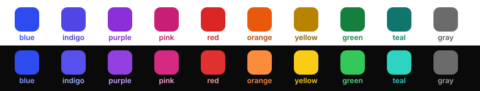

# Getting started: Next.js


> A Clegra app is an app that Clegra draws natively and that is also a plain MCP server for ChatGPT, Claude and any
> MCP client. One package, `@clegra/sdk` (ESM JavaScript with its
> types, Node 20+; `npm i @clegra/sdk@next zod`). Its design library is the separate package `@clegra/ui` (optional). For a Next.js app that already has data and a sign-in: **five
> minutes to see it, a day to ship it.**


> The other guide: [plain JavaScript](start-javascript.md) (any runtime with Fetch: Node, Deno, Bun, a worker). Pages,
> tests, your data layer and kinds are the same for both: they are at the end of that guide.

## Next.js in 5 minutes

In an existing Next.js App Router app (`app/` or `src/app/`):

```sh
npm i @clegra/sdk@next zod
npx @clegra/sdk init          # --dry-run prints what it would do; --ui adds @clegra/ui, Clegra's design system
```

```text
clegra init: Next.js 16.4.6, App Router in app/, TypeScript, alias @/*, next.config.ts

  create  clegra/task.ts  (the entity: sample tasks; a TODO for your data)
  create  clegra/complete.ts  (a confirmed record action)
  create  clegra/tasks.ts  (a list page)
  create  clegra/app.ts  (defineApp: the three assembled)
  create  clegra/index.ts  (serve(app, { auth }): a TODO for your sign-in)
  create  app/api/clegra/[...path]/route.ts  (imports { served } from "@/clegra")
  edit    next.config.ts  (wrapped the exported config with withClegra)
  create  .env.local  (CLEGRA_LOCAL_TOKEN: a random local bearer, refused in production)

Next:
  1. npm run dev   (then http://localhost:3000/.well-known/clegra.json is the manifest, http://localhost:3000/mcp the MCP server)
  2. npx @clegra/sdk check http://localhost:3000 --token <the token>
  3. MCP Inspector: npx @modelcontextprotocol/inspector, Streamable HTTP, http://localhost:3000/mcp, header Authorization: Bearer <the token>
  4. A day to ship: …
```

What it writes:

- **`clegra/`**, one file per thing: the entity `task` (`defineEntity`, on sample data kept in the file, scoped by
  `ctx.installation`), the confirmed record action `complete` (`defineAction({ on: task, … })`), the list page
  `tasks` (`definePage({ list: task, … })`), `app.ts` (`defineApp({ entities: [task], actions: [complete], pages:
  [tasks] })`: pure, nothing served) and `index.ts` (`serve(app, { auth })`: how it runs). Two `TODO`s mark where
  your database and your sign-in go.
- **`app/api/clegra/[...path]/route.ts`**: `export const { GET, POST, DELETE, OPTIONS } = toNextHandlers(served)`.
- **`next.config`** wrapped in `withClegra(…)`. It adds rewrites for `/mcp`, `/.well-known/clegra.json`,
  `/openapi.json`, `/operations/…`, the sign-in module's `/oauth/…` and the OAuth metadata paths. init edits the file only when the edit is certain (one
  `export default <expression>` line). Otherwise it prints the edit for you to make.
- **`.env.local`**: `CLEGRA_LOCAL_TOKEN`, a random bearer.

init never overwrites a file. Running it twice only prints `skip`s. It warns about what would get in the way: a
`proxy.ts` (or `middleware.ts`) that would block `/mcp`, `basePath` or `trailingSlash: true` (which `withClegra`
refuses), a `.gitignore` that doesn't cover `.env.local`, and missing `@clegra/sdk`/`zod`.

Then:

```sh
npm run dev
npx @clegra/sdk check http://localhost:3000 --token <CLEGRA_LOCAL_TOKEN>
```

- **The MCP Inspector**: `npx @modelcontextprotocol/inspector`, transport Streamable HTTP, URL
  `http://localhost:3000/mcp`, header `Authorization: Bearer <CLEGRA_LOCAL_TOKEN>`. You see `task_list`,
  `task_get`, `task_complete`, `search`, `fetch`, `open_tasks` and `clegra_resolve`. The same operations are an
  OpenAPI 3.1 document at `http://localhost:3000/openapi.json`, callable as `POST /operations/<tool>`
  ([spec §7](spec.md#the-index-as-openapi)).
- **`clegra check`** runs every check. All of them pass but one: `auth.mcp — protected-resource metadata names no
  authorization server`. That is the honest state of a fresh app. MCP clients can't sign anyone in until the app has
  its sign-in, which is the first job of day one.

**The local bearer, and why it is safe.** The generated `resolve` accepts `CLEGRA_LOCAL_TOKEN` only when
`NODE_ENV` is not `production`. `next build`, `next start` and every deployment (Vercel previews included) set
`production`, and then the bearer is refused whatever the environment holds. In production without
`CLEGRA_PUBLIC_URL`, every request but the manifest gets a `500 misconfigured` that names the missing setting. The token is random
per project and lives in `.env.local`, which Next's `.gitignore` keeps out of git. The SDK's development sign-in
(`devSignIn` of `@clegra/sdk/signin`: test people, a code printed on the console) also works under Next, for linking
a real client locally; its development tokens and proofs (what `testClient` uses) never count there, since they trust
only loopback callers and a route handler can't know the caller's address. `auth.anonymous` (no token at all) is
not used either: it is a local demo's, refused in production. Operations anyone may call without signing in are
declared `public: true` with `auth.public` (spec §7, «Public operations»).

## Your app's colour

Each app has its own tint colour, like Apple's apps: Clegra draws the app's primary buttons, selected rows and
filters, links, switches and focus ring in it, and keeps its own chrome blue. Pick one name of the palette (never a
hex: the palette is tuned for light and dark and for contrast):

```ts
export const app = defineApp({ name: "acme-tasks", title: "Tasks", version: "1.0.0", accent: "teal", … })   // clegra/app.ts
```



| `accent` | Light | Dark |
| --- | --- | --- |
| `blue` (the default) | `#2D4BEE` | `#2D4BEE`, text `#8FA2FF` |
| `indigo` | `#4F46E5` | `#5850EC` |
| `purple` | `#8B2FD9` | `#9340E0` |
| `pink` | `#C81E73` | `#D42A82` |
| `red` | `#D02424` | `#E0302F` |
| `orange` | `#EA580C` | `#FB8C3C` |
| `yellow` | `#B88300` | `#FACC15` |
| `green` | `#127535` | `#34C759` |
| `teal` | `#0F716A` | `#2DD4BF` |
| `gray` | `#636363` | `#6B6B6B` |

Choose the one closest to your icon. Anything else fails when the app starts (`accent: "#00AA88" is not one of …`)
and in `clegra check` (`manifest.schema`). Without `accent` the manifest has none and hosts use `blue`.

## A day to ship

Work through the TODOs in `clegra/`:

1. **Your data in `get`, `list` and `run`.** Call the functions your pages already use, with `ctx.installation` as
   the tenant. [Your data layer](#your-data-layer) below shows a `list` over SQL.
2. **Your sign-in, in `clegra/index.ts`.** Either the SDK's sign-in module over your login:
   `auth: { signIn: createSignIn(app, { issuer, resource, login, permissionsOf, store, keys }) }` (or over its
   `passwordLogin` when you have no login), which gives every MCP client a delegation your app issues; or, when your
   auth library already is an OAuth authorization server (better-auth, Clerk, Auth0, WorkOS), `auth.resolve` and
   `auth.authorizationServers`: `resolve` verifies its access tokens and names the caller. Both in
   [auth.md](auth.md). Keep the `localCaller` line if you like; it never answers in production.
3. **The public address.** Set `CLEGRA_PUBLIC_URL=https://app.example.com` (an origin only) in each environment.
   `auth.resource` is then `https://app.example.com/mcp`, the only audience tokens are accepted for. Without it,
   production answers `500 misconfigured` (the manifest excepted). A client can send `x-forwarded-host`, so never rely on it. On Vercel,
   previews have other hosts: give each environment its own value.
4. **A shared store.** On serverless or with several instances, serve with
   `store: new SqlStore((text, params) => pool.query(text, params))`. It keeps write results (idempotency) and
   one-time token ids in your Postgres (and the runs of `later` actions, below). `SqlStore.schema()` gives its
   tables (`clegra_store`, `clegra_store_later`) for a migration, `CREATE … IF NOT EXISTS`: run it as a migration,
   never at startup, and again in a new migration when you upgrade.
5. **`clegra check` in CI.** Get a token for a test user through the real OAuth flow, then run
   `CLEGRA_TOKEN=… npx @clegra/sdk check https://preview.example.com`. The exit code is 0 when conformant, 1 when a
   check failed, and 3 when there was no token (only the public checks ran).
6. **Connect Claude and ChatGPT.** They need https: your deployment, or `cloudflared tunnel --url
   http://localhost:3000` locally. Note that a tunnel's host is not `CLEGRA_PUBLIC_URL`, and your authorization
   server must also be reachable there. Add `https://app.example.com/mcp` as a connector and sign in with your own
   sign-in. Lists, records and dashboards show as MCP Apps views. Clients identify themselves with a Client ID
   Metadata Document, so your authorization server must support CIMD (see [auth.md](auth.md)).
7. **Your own site in Clegra.** `site: { start: "/" }` and `clientOrigins` (Clegra's client origins) in
   `serve` show your real pages in Clegra's clients, in a frame (spec §5.1). The person signs in there with your
   own sign-in, so its session cookie must be `Secure; SameSite=None; Partitioned` over https
   ([auth.md](auth.md), «Your own site in a client's frame»). Two more pieces:
   - `proxy.ts`: `export const proxy = siteProxy(served)` over every page (framable by those client origins only);
   - in the root layout `<ClegraSite />` (the bridge: the client's theme and language, where the person is).

What needs https: every remote MCP client (Claude, ChatGPT), and any authorization server they reach. What doesn't:
the Inspector, `clegra check` and workspace hosts on your machine.
